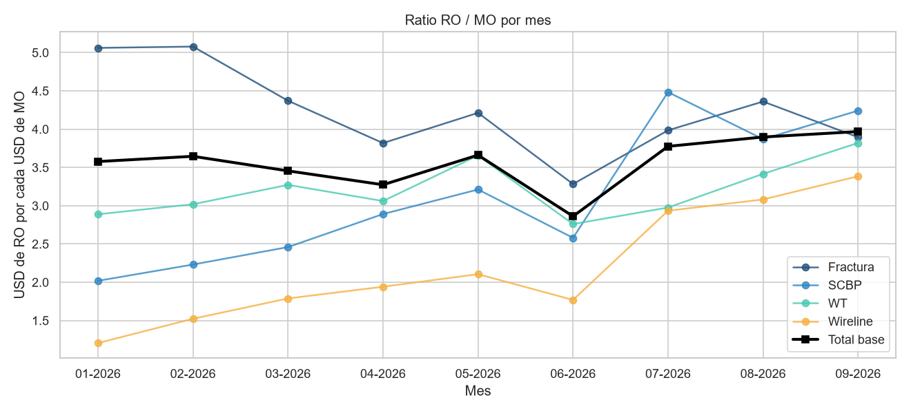

# KPI Mano de Obra

**Autor:** Lucas Doria
**Curso:** Herramientas básicas para el Análisis de Datos – Centro de e-Learning UTN BA
**Cohorte:** 185761

## Objetivo

Analizar cómo evolucionó el costo de la mano de obra (dotación, sueldos y horas extras) por línea de servicio entre enero y septiembre de 2026 en una empresa de servicios petroleros, y cuánto resultado operativo (RO) generó cada dólar pagado en mano de obra (MO).

Subpreguntas: ¿qué línea depende más de las horas extras? ¿El ratio RO / MO mejoró o empeoró y en qué líneas?

## Dataset

El caso se basa en un proyecto real, pero por confidencialidad **los datos son simulados**: respetan la estructura de los reportes de la empresa, no sus valores.

- [nomina_liquidaciones_2026.csv](data/raw/nomina_liquidaciones_2026.csv): 10.865 filas, una por legajo, mes y concepto liquidado (ARS).
- [pl_lineas_2025_2026.csv](data/raw/pl_lineas_2025_2026.csv): P&L mensual por línea (USD).
- [tipo_cambio_bcra_2026.csv](data/raw/tipo_cambio_bcra_2026.csv): tipo de cambio de fin de mes del [BCRA](https://www.bcra.gob.ar/PublicacionesEstadisticas/Tipos_de_cambios.asp).

## Pasos realizados

1. **Limpieza en Python** ([notebook](notebooks/eda_mano_de_obra.ipynb)): 86 duplicados eliminados, fechas en 3 formatos unificadas, importes en texto convertidos, departamentos estandarizados, grupo faltante completado por legajo, horas imposibles (999) anuladas y conversión a USD.
2. **EDA:** 5 gráficos con matplotlib y seaborn, cada uno con su interpretación.
3. **KPIs:** ratio RO / MO, % de horas extras sobre el costo laboral y costo por persona.
4. **Dashboard en Power BI** ([.pbix](dashboard/kpi_mano_de_obra.pbix) · [PDF](dashboard/kpi_mano_de_obra.pdf)): lee las tablas de `data/processed/`. Las consultas y medidas están en [dashboard/](dashboard/).

## Resultados principales

| KPI (ene-sep 2026) | Valor |
|---|---|
| Ratio RO / MO | 3,54 (2025: 3,32) |
| % horas extras sobre costo laboral | 13,7% |
| Costo laboral por persona | USD 5.440 / mes |

- La dotación creció 6,4%, pero cambió la composición: Fractura bajó de 121 a 96 personas y SCBP subió de 50 a 80.
- Wireline es la línea más dependiente de horas extras (23,8% de su costo).
- El ratio cayó en junio por el aguinaldo y subió a 3,97 en septiembre, impulsado por SCBP y Wireline.



## Cómo reproducirlo

```
pip install -r requirements.txt
jupyter notebook notebooks/eda_mano_de_obra.ipynb
```

## Fuentes

- pandas: https://pandas.pydata.org/docs/
- matplotlib: https://matplotlib.org/stable/
- seaborn: https://seaborn.pydata.org/
- DAX, función DIVIDE: https://learn.microsoft.com/es-es/dax/divide-function-dax
- Tipo de cambio: BCRA, https://www.bcra.gob.ar/PublicacionesEstadisticas/Tipos_de_cambios.asp
- Imágenes: elaboración propia (gráficos del [notebook](notebooks/eda_mano_de_obra.ipynb) y del dashboard).
